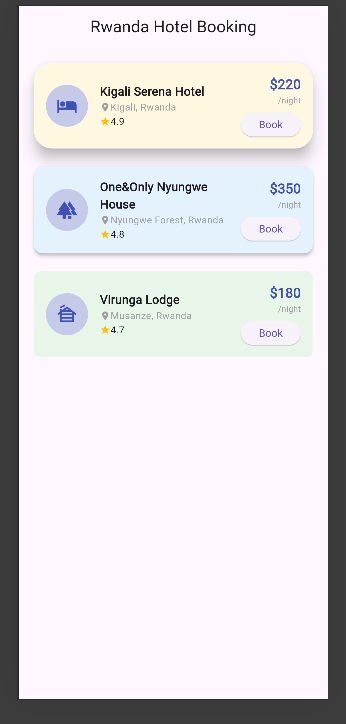

# Flutter Card Widget Demo

A simple Flutter app demonstrating the `Card` widget through a real-world hotel booking scenario.

---

## Widget

**Card** — a Material Design surface that groups related content with elevation, color, and rounded corners.

---

## How to Run

1. Make sure Flutter is installed: https://docs.flutter.dev/get-started/install
2. Clone this repo:
   ```
   git clone <your-repo-url>
   ```
3. Navigate into the project:
   ```
   cd "Card widget/Card_Widget"
   ```
4. Get dependencies:
   ```
   flutter pub get
   ```
5. Run the app:
   ```
   flutter run
   ```

---

## Three Card Properties Demonstrated

| Property | What it does |
|----------|--------------|
| `elevation` | Controls the shadow depth beneath the card. Higher value = more shadow, making the card appear to float higher above the surface. |
| `color` | Sets the background color of the card. Used here to give each hotel a distinct soft background tone. |
| `shape` (via `RoundedRectangleBorder`) | Controls the corner radius of the card. A higher `borderRadius` value produces more rounded corners. |

---

## Screenshot



---

## Notes

- Hotel data is stored as Dart Records (tuples) for simplicity.
- Each card uses different `elevation`, `color`, and `borderRadius` values so the visual difference is easy to see during the demo.
